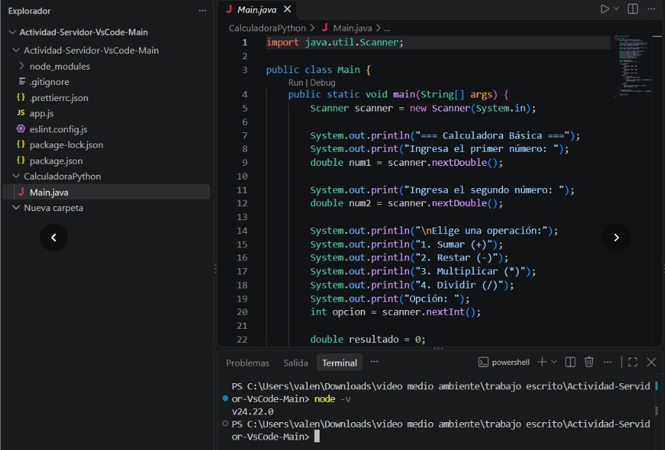
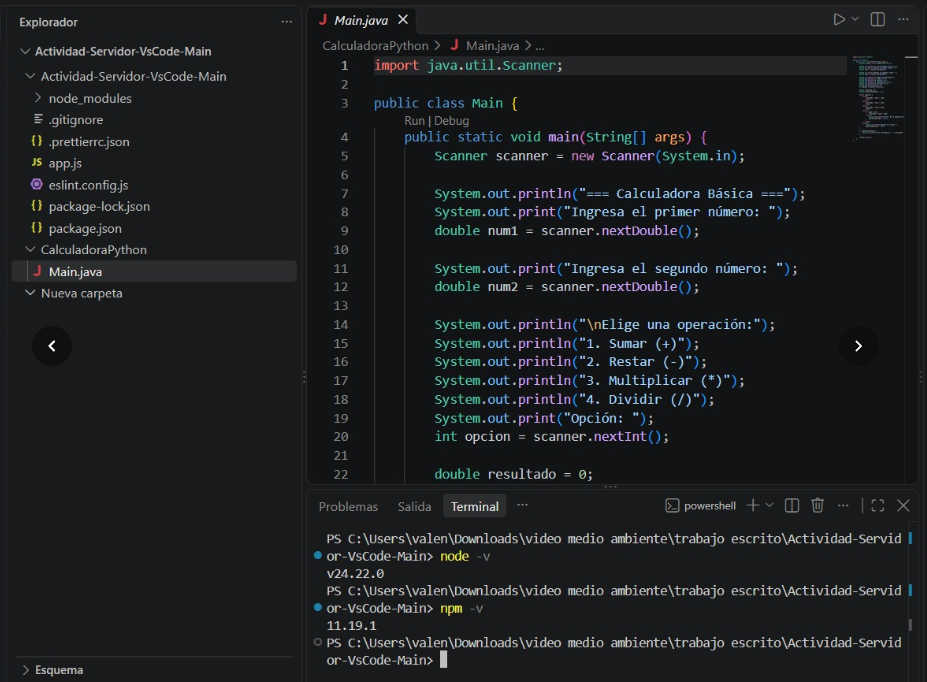
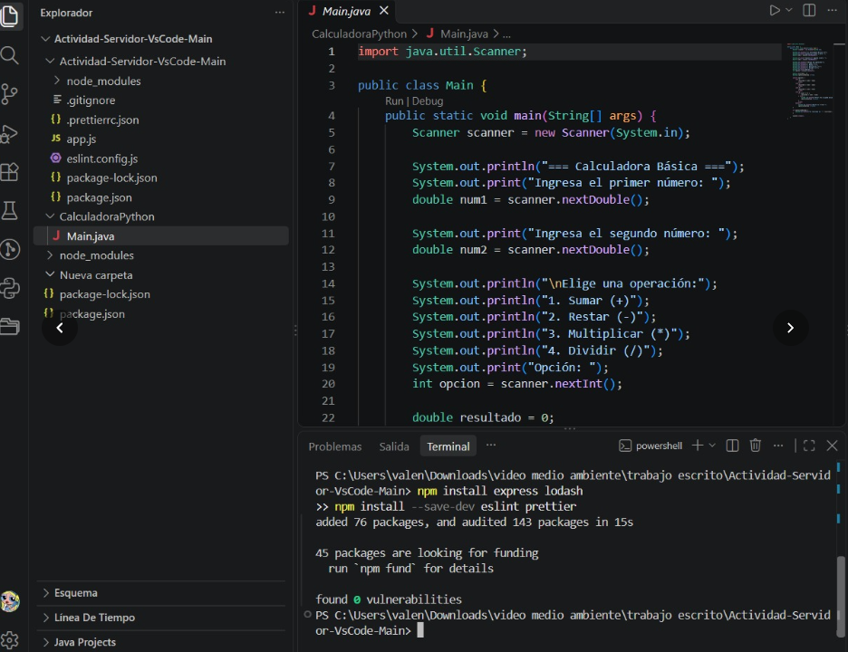
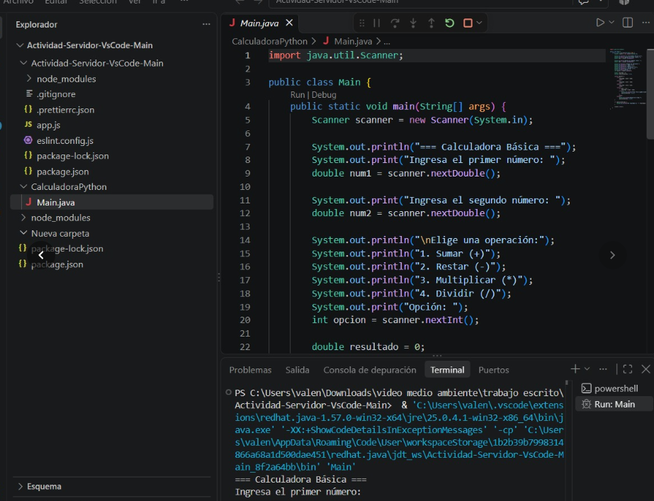
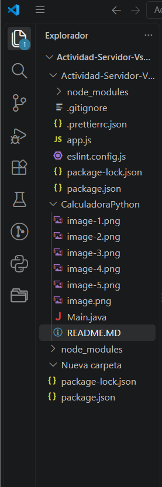

# INFORME DE CONFIGURACIÓN DEL ENTORNO DE DESARROLLO

## INTRODUCCIÓN
El objetivo principal de esta actividad es realizar la instalación, verificación y configuración avanzada de un entorno de desarrollo local orientado a JavaScript / Node.js utilizando el editor de código Visual Studio Code.

Un entorno de desarrollo bien estructurado permite a los desarrolladores gestionar dependencias de forma aislada, garantizar la calidad del código mediante formateadores y linters, y ejecutar proyectos de manera consistente. En este informe se documenta paso a paso el proceso de verificación de herramientas básicas, la inicialización de proyectos con npm, la instalación de paquetes y linters, y la resolución de problemas comunes presentados durante la ejecución.

## PASOS DETALLADOS DE CONFIGURACIÓN

**Paso 1: Verificación de Herramientas Básicas:** 

Para comenzar, se verificó que Node.js y el gestor de paquetes npm estuvieran correctamente instalados y reconocidos por el sistema operacional en la terminal integradadel entorno Visual Studio Code (PowerShell).

*Se ejecutó el comando para verificar la versión de Node.js:*

*Se ejecutó el comando para verificar la versión del gestor de paquetes npm:*

## Configuración Avanzada e Instalación de Dependencias

A continuación, se procedió con la inicialización del proyecto y la instalación de dependencias necesarias tanto para la lógica de la aplicación como para el control de calidad de código.

*Inicialización del proyecto:*

Se ejecutó npm init -y para generar el archivo package.json base del proyecto.

*Instalación de dependencias del proyecto y de desarrollo (Linters y Formateadores):*

Se instalaron los paquetes de aplicación (express, lodash) junto con las herramientas de calidad de código y formateo (eslint, prettier) como dependencias de desarrollo mediante el siguiente comando:

## Archivos de configuración creados:

En el árbol del proyecto (Actividad-Servidor-VsCode-Main) se estructuraron exitosamente los siguientes archivos de configuración e infraestructura:

- package.json y package-lock.json: Control de versiones y dependencias.

- .eslintrc.js / eslint.config.js: Reglas de análisis estático de código.

- .prettierrc.json: Reglas de formato automático de código.

- .gitignore: Exclusión de carpetas pesadas como node_modules/.

- app.js: Archivo principal de la aplicación.

## Verificación de Ejecución de Código 

Adicionalmente, se probó el flujo de ejecución de proyectos dentro del entorno VS Code, incluyendo la compilación/ejecución mediante la terminal de comandos integrada y el soporte de extensiones para Java/Python.

## ESTRUCTURA DEL PROYECTO

La estructura de carpetas y archivos resultante en el área de trabajo es la siguiente:

